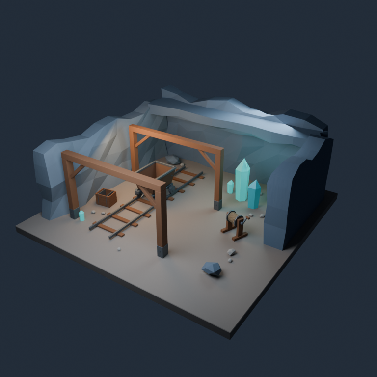
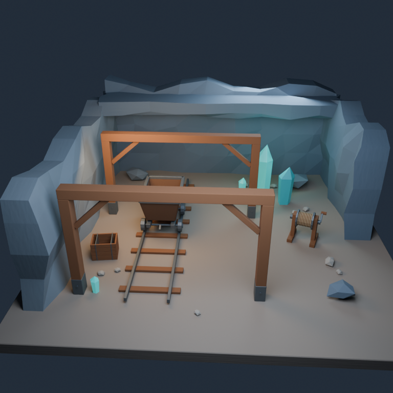
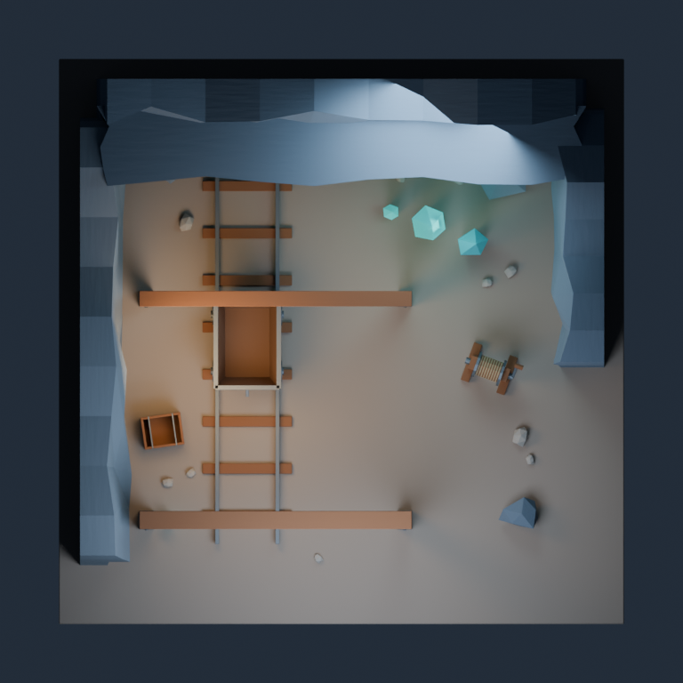
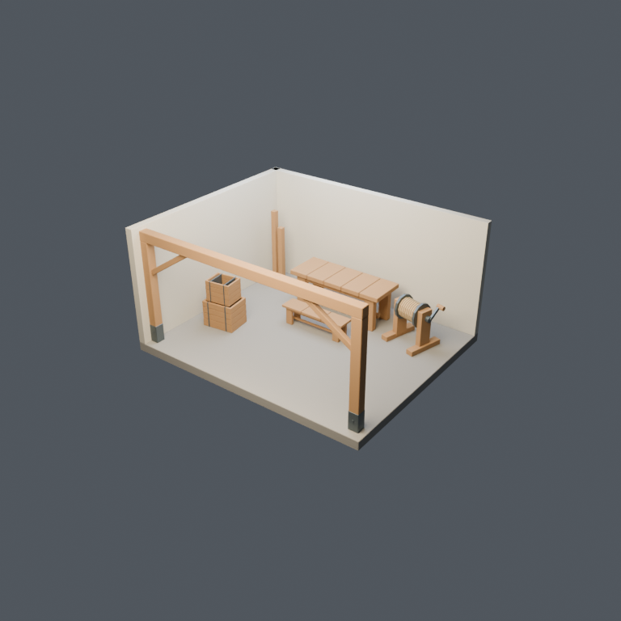

# AI Scene Architect v0.2 驗證報告

日期：2026-11-15（Asia/Taipei）

**總結：PASS_WITH_WARNINGS。** 已完成文字需求 → AI 規劃 JSON → Schema/關聯驗證 → 程序化建模組裝 → 可編輯 Blender 場景 → GLB → 多視角讀圖 → 受限修正的工作流程。技術驗證通過；礦洞仍有輕微美術與配置警告，最終美術接受度保留給使用者。

這是由具備讀圖能力的 AI 代理運作的技能與工具系統。Python 不包含自然語言模型，也不是用關鍵字選擇固定礦洞模板。此次兩份規劃由本次 AI 依各自 `brief.txt` 撰寫，組裝器沒有場景類型分支或固定位置清單。獨立執行 Python 不會自行理解新的自然語言需求。

## 基礎、環境與保護範圍

- 從 PR #1 HEAD `3a9ee718ffc273f35e915e6e653c4a9753ca3d0d` 建立 `feat/scene-planning-v02`。
- PR #1 查詢時仍為 open/draft、未合併；v0.2 Draft PR 的 base 應為 `feat/visual-review-guard`，保留分支依賴。
- main 保持 `0760407b9c66112ad2d7df1151788908724e7073`，未合併或發布版本。
- 已安裝的 Steam Blender：`D:\SteamLibrary\steamapps\common\Blender\blender.exe`。
- 實測 5.3.0，build hash `02f0899d78e3`；內建 Python 3.13.13，系統 Python 3.14.4。
- Windows 登錄：25H2、build 26200.9974，ProductName 舊欄位顯示 Windows 10 Pro；沿用前次實機環境。
- 沒有安裝或更新工具、Python 套件，也不依賴付費 3D 服務。
- 全部先前 `evidence/pr1-windows` 檔案 SHA-256 保持不變；此目錄留在本機，未重新加入 v0.2 PR。
- 五個版本化場景的 `.blend` / GLB 與全部預覽檔案雜湊均通過稽核。未覆寫原始素材、初稿或中間版本。

## 實作交付

- [技能入口](../../skills/ai-scene-architect/SKILL.md)、[規劃契約與建模目錄](../../skills/ai-scene-architect/references/scene-planning.md)、[JSON Schema](../../skills/ai-scene-architect/references/scene-plan.schema.json)。
- [文字規劃請求](../../skills/ai-scene-architect/scripts/prepare_planning.py)、[Schema 與語意驗證](../../skills/ai-scene-architect/scripts/scene_plan.py)。
- [可重用建模函式](../../skills/ai-scene-architect/scripts/builders.py)：9 種 kind、12 種含 variant 的構造，具尺寸、種子、幾何粗糙度、分段、倒角與斜撐參數。
- [場景組裝](../../skills/ai-scene-architect/scripts/build_scene.py)、[完整技術管線](../../skills/ai-scene-architect/scripts/run_scene.py)、[重開／重新匯入驗證](../../skills/ai-scene-architect/scripts/verify_scene.py)、[檢視紀錄追加工具](../../skills/ai-scene-architect/scripts/review_history.py)。
- v0.1 `iteration_guard.py` 未更動。預覽器只增加可選的三個既有攝影機名稱，省略時仍走原有流程。
- 各 iteration 附 `scene_plan.json`、build manifest、來源程式快照 ZIP；原始快照資料夾也保留在本機。最新驗證器另外補查 PBR 值，不修改封存場景。

## 正式案例：奇幻水晶礦洞

- [原始文字需求](../../examples/crystal-mine/brief.txt)、[最終 AI 規劃](../../examples/crystal-mine/scene_plan.json)。
- [可編輯 .blend](../../output/v02/crystal-mine/iteration-2/scene.blend)、[GLB](../../output/v02/crystal-mine/iteration-2/scene.glb)。
- 18 個資產定義、38 個場景組件、115 個可編輯 mesh parts、4,872 三角形。
- 12×12 公尺地面；不規則連續岩壁、後部剖面岩頂、入口／內部木支架、雙軌與枕木、空心料斗礦車、不同高度的青色發光水晶、散落礦石、儲物木箱、手動絞盤。
- 礦車具四輪、雙軸、輪轂、底架、斜壁料斗、上緣與鉚釘，並非整塊立方體代理物。
- 以後右晶簇為焦點，偏左運礦軌道與右側步行路徑分開；不使用粒子或泛光填補細節。
- 全部 36 項宣告的支撐接觸通過 bounds 檢查，步行路徑沒有候選阻擋警告。







已逐張開啟三張 authored PNG，也逐張開啟 GLB 重新匯入後的三張診斷 PNG。皆為 768×768，可辨識主要結構、礦車、水晶及地面配置。GLB 診斷圖使用額外中性補光且未降噪，有明顯取樣雜訊；不把它當成與 Blender 原照明完全一致的美術結果。

## 第二案例：木工作坊

- [不同文字需求](../../examples/woodwork-shop/brief.txt)、[AI 規劃](../../examples/woodwork-shop/scene_plan.json)。
- [可編輯 .blend](../../output/v02/woodwork-shop/iteration-1/scene.blend)、[GLB](../../output/v02/woodwork-shop/iteration-1/scene.glb)。
- 9 個資產定義、11 個場景組件、93 個 mesh parts、4,052 三角形。
- 6×5 公尺開放剖面工作坊：灰白牆、柱樑、分板工作桌、長凳、疊放木箱、備用木材與手動絞盤。無水晶、礦洞或發光配色。
- 與礦洞共用地面、木構件、支架、家具及機械 builder；木箱與備用木材 instance 共用 mesh data，物件／父節點可獨立編輯，必要時可在 Blender Make Single User。
- 10 項支撐檢查通過；配置候選警告為 0。
- 已逐張開啟三張 authored 及三張 GLB 診斷圖，確認中央空間、家具支腳、疊箱與絞盤結構可讀。



## 測試結果

| 項目 | 結果 | 證據 |
|---|---|---|
| Python 全部單元測試 | PASS，39/39，無跳過 | [unit-tests-final.log](unit-tests-final.log) |
| 既有 v0.1 修正規則測試 | PASS，原有 10 項包含在 39 項內 | 同上 |
| Blender builder 契約測試 | PASS，4/4，其中逐一檢查 12 種構造 | [blender-contract-checks.log](blender-contract-checks.log) |
| 各構造尺寸、底高、UV、封閉邊及朝外法線 | PASS | 同上 |
| 自然形狀相同 seed 重現、不同 seed 變化 | PASS | 同上 |
| 相同資產 mesh data 重用與獨立物件 | PASS | 同上 |
| 兩組 AI 計畫 Schema／關聯驗證 | PASS | 單元測試與實際 build |
| Blender 5.3.0 實際建模與三視角 | PASS，兩組完整執行 | 各 iteration 的 build/render.log、manifest |
| .blend 新程序重開 | PASS，兩組 | [礦洞](../../output/v02/crystal-mine/iteration-2/verify-blend-final.json)、[工作坊](../../output/v02/woodwork-shop/iteration-1/verify-blend-final.json) |
| GLB 新程序匯入 | PASS，兩組 | [礦洞](../../output/v02/crystal-mine/iteration-2/verify-glb-final.json)、[工作坊](../../output/v02/woodwork-shop/iteration-1/verify-glb-final.json) |
| 匯出前後 mesh 名稱、bounds、三角形、材質及 hierarchy | PASS | 同上 |
| GLB PBR 顏色、粗糙度、金屬度、有效發光值 | PASS | 同上，portable_pbr_material_factors_match |
| 無無效座標、退化三角形，全 mesh 有 UV | PASS | 同上 |
| 真正讀圖 | PASS，兩組最終 authored 與 GLB 共 12 張，並檢視先前草稿 | 檢視紀錄及本報告 |
| 既有輸出、載入中的來源、第三次修正、無效攝影機 | PASS，皆拒絕且未產生未授權輸出 | [artifact-audit-final.json](artifact-audit-final.json) |
| v0.1 原檔與所有既有證據保護 | PASS | 同上 |
| v0.1 預設預覽回歸 | PASS，三張解壓縮 PNG 像素資料完全相同 | 同上及 v01-regression/ |
| 預設最多兩次、初次不扣額度、不限制總時間 | PASS | 原有測試、實際 journal、拒絕第三次測試 |
| 重複／無改善只警告 | PASS | 原有測試，未添加新的停止條件 |

一次稽核最初錯把「PNG 整檔 SHA 相同」當成重渲染相同標準，因時間等中繼資料改變而 FAIL。保留 [原始稽核](artifact-audit.json)；後續比較 IHDR 與解壓縮 IDAT，確認像素相同。這是驗證方式修正，沒有改動 v0.1 或其原始證據。

## 實際修正歷史

| 案例 | iteration 0 | iteration 1 | iteration 2 / 最終 |
|---|---|---|---|
| 礦洞 | 4 個問題、嚴重度總和 6 | 修正柱腳／軌道、輪廓、構圖與照明；3 個問題、總和 4 | 岩頂接合及遮擋改善；剩 1 個輕微岩頂造型問題，stop / revision_budget_reached |
| 工作坊 | 2 個問題、總和 2 | 次視角與共用幾何法線檢查後無需要修正的視覺問題 | 提前 stop / no_remaining_issues，未做第二次修改 |

- [礦洞累積紀錄](../../output/v02/crystal-mine/visual-history.json)、[停止決策](../../output/v02/crystal-mine/final-guard.json)。
- [工作坊累積紀錄](../../output/v02/woodwork-shop/visual-history.json)、[停止決策](../../output/v02/woodwork-shop/final-guard.json)。
- 未重設歷史、未透過重新命名繞過次數。礦洞 iteration 2 後沒有再修改／重建場景；後續僅做唯讀匯入檢查、工具邊界測試與文件整理。
- 達上限時原 v0.1 guard 的 stop 結果不包含 warnings；原行為保留，配置警告另由 layout-checks 與報告呈現。

## 已知限制與後續建議

1. **美術警告：** 礦洞為可讀的低模剖面完整小場景，但後部岩頂仍有板狀、模組化輪廓。已達兩次修正上限，停止並保留給使用者評估。下一階段可新增通用隧道截面／連續有機封閉體 builder，並非繼續偷偷修此案例。
2. **配置候選：** 最終礦洞仍有 `left_boulder` / `ore_3` 一項 AABB 重疊候選。這不是精確表面穿透證明，後部岩頂也限制檢視角度；保留為未完全判定警告。支架與鐵軌的明確衝突已排除。
3. **匯出差異：** GLB 的幾何、UV 與 PBR 因子通過驗證；程序化 bump 未烘焙，AREA/World 燈光不支援，目的端須重新照明。診斷重渲染已明確換光，不聲稱原照明等價。[官方限制](https://docs.blender.org/manual/en/5.3/addons/scene_gltf2.html)。
4. **配置檢查邊界：** 支撐與碰撞使用 part bounds / 路徑取樣，不是精確表面碰撞、結構力學、導航或完整防懸空求解器。傾斜不規則物件、凹形支撐需額外檢視。
5. **系統範圍：** 目前是有限 builder 目錄、代理主導的通用小場景系統，並非任意文字都能產生任意模型。規劃與視覺判斷需要 AI；`visual_reviewed` 與合作式 journal 無法防止外部人為刪檔或虛報。
6. **UV 與效能：** 提供基礎逐面投影 UV，沒有唯一打包、光照貼圖、LOD、碰撞網格、引擎內效能量測或 Godot/Unity 驗收。
7. **平台版本：** 實測範圍是此機器的 Windows / Steam Blender 5.3.0 CPU Cycles。沒有宣稱其他 Blender 版本、GPU 或引擎相容性。

建議下一階段按需求先選「連續有機結構」或「可攜材質／UV 烘焙」，再增加表面級接觸檢查與引擎驗證。此次不擴大實作。

## 重現與檔案說明

```powershell
python -m unittest discover -s tests -v
& 'D:/SteamLibrary/steamapps/common/Blender/blender.exe' --background --factory-startup --python-exit-code 1 --python tests/blender_contract_checks.py
python skills/ai-scene-architect/scripts/scene_plan.py examples/crystal-mine/scene_plan.json
python skills/ai-scene-architect/scripts/scene_plan.py examples/woodwork-shop/scene_plan.json
```

新的建場工作使用 README 的 `run_scene.py` 指令及新輸出目錄；本次已停止的歷史不能再拿來修場景。可唯讀重開交付 `.blend`，或以 `verify_scene.py` 將驗證結果寫到新的 JSON。`tests/audit_v02_evidence.py` 是此本機已建置證據的稽核，需要保留的 v0.1 證據與 v0.2 輸出；不是乾淨 checkout 的一般單元測試。

各生成 manifest 保存執行當時絕對路徑，`verify_scene.py` 以 manifest 所在目錄找場景檔，可搬移後重新驗證；新規劃與建場也會產生當地新 manifest。保留舊 manifest 的雜湊，不改寫既有證據。

結構參考與官方 API 查核見 [reference_notes.md](reference_notes.md)。下載的博物館照片沒有加入模型或 PR。未合併 PR、未發布版本。
