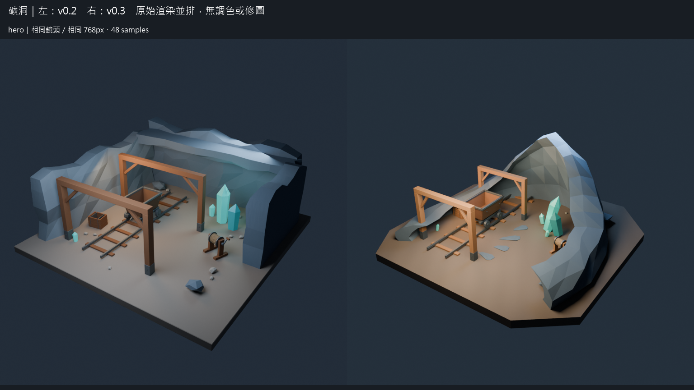
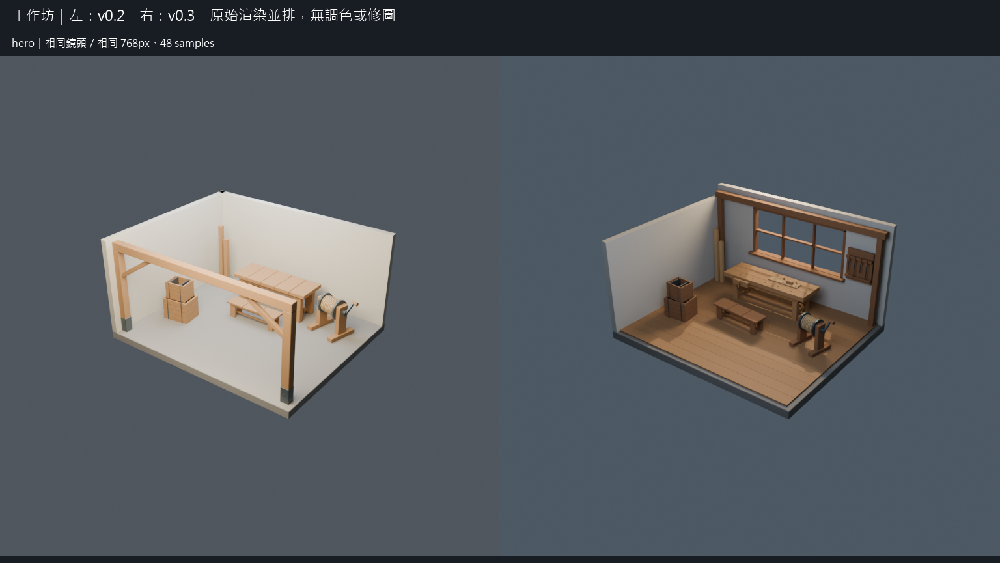
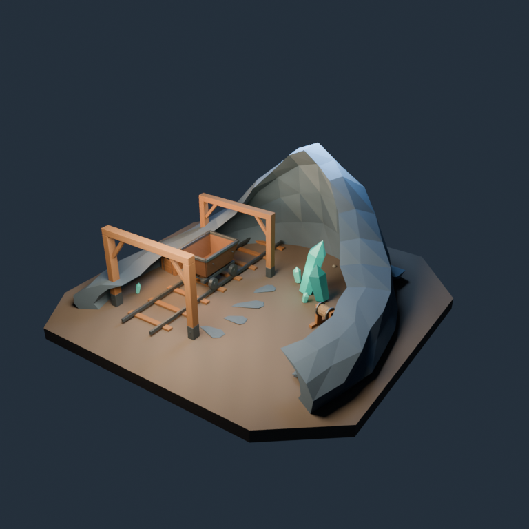
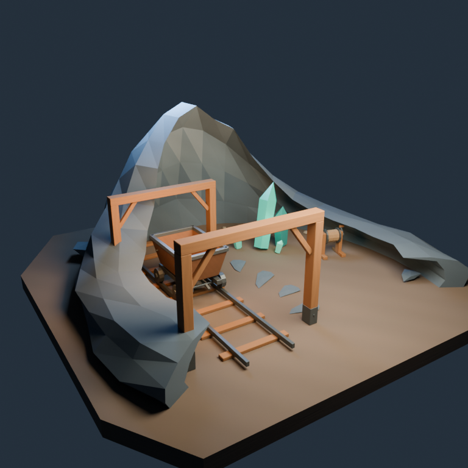
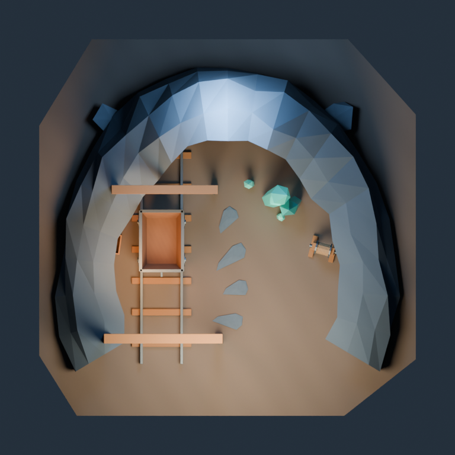
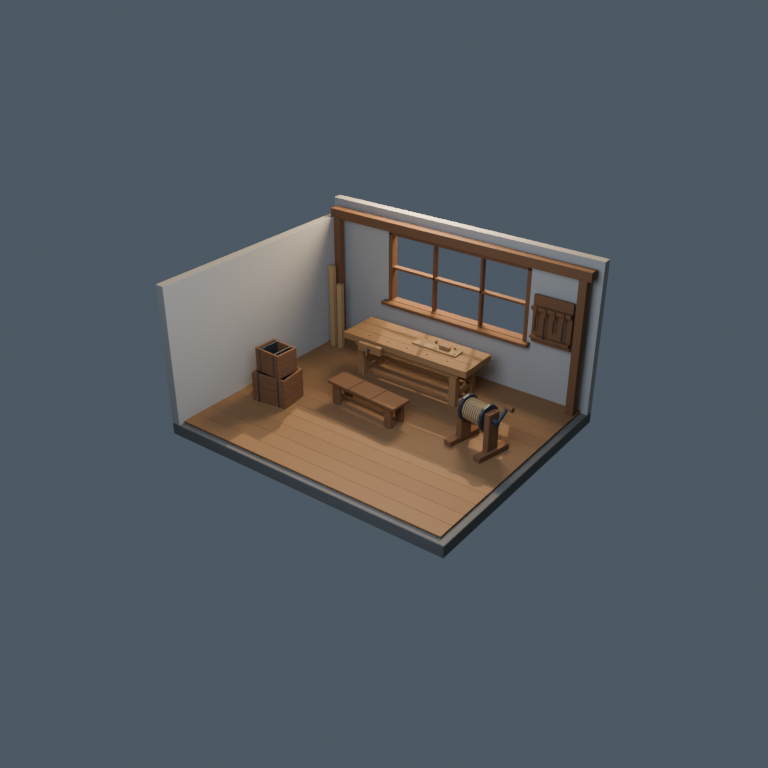
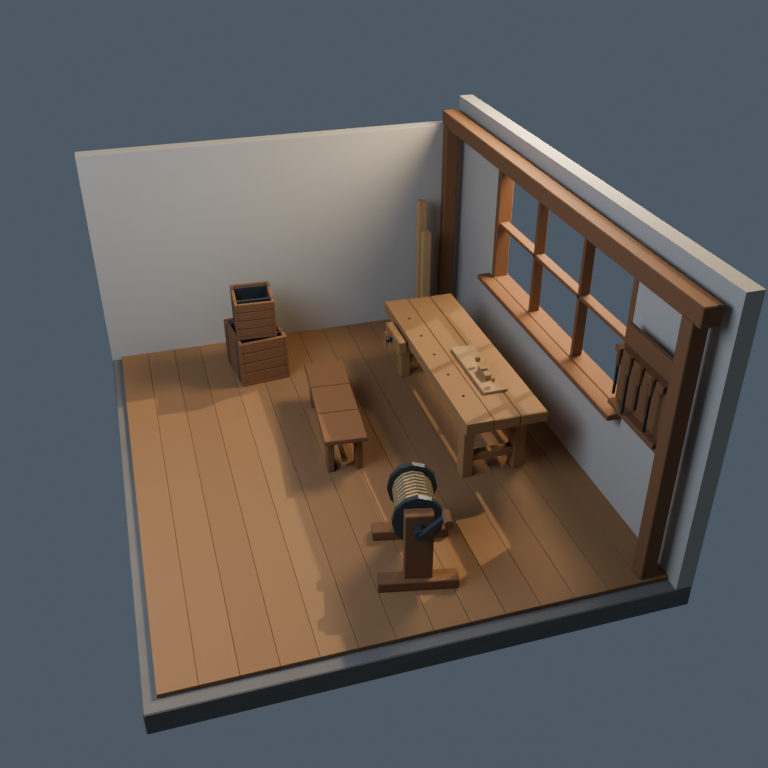
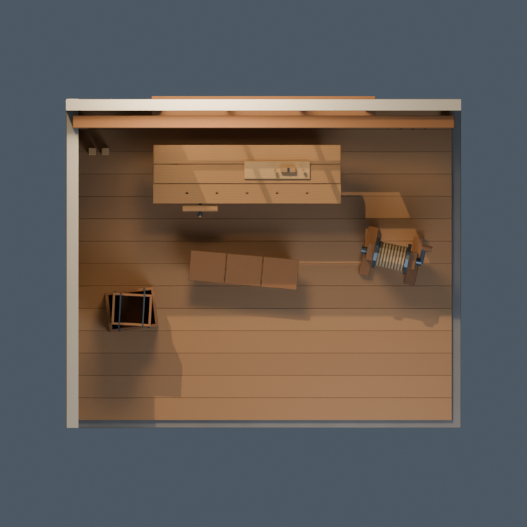

# v0.3 — AI Scene Visual Quality Validation

日期：2026-11-16（Asia/Taipei）。

**整體結果：PARTIAL。工作坊有可見改善；礦洞未完整通過美術目標。兩者最終技術檢查皆 PASS。**

這次真正執行 PR #3《靜默的斷脈》及《午後停工》，改動幾何、配置、比例、材質與照明。不是只改敘述，也不以程式測試或網格數宣稱美術成功。兩場景各用新的初次渲染及兩次修正，已停止；沒有改寫 v0.2 成果或重設其 journal。

## 分支與執行環境

- PR #1、#2、#3 查詢時皆 open/draft、未合併。
- 依賴：main → PR #1 `3a9ee71` → PR #2 `b719a36` → PR #3 `868723a` → 本次 `feat/visual-quality-v03`。
- 本分支從 PR #3 HEAD `868723a3e1c235150696f91cfb15836fdbd1b031` 建立；Draft PR base 為 `feat/ai-reference-scout`。main 保持 `0760407b9c66112ad2d7df1151788908724e7073`。
- Windows Steam Blender **5.3.0**：`D:\SteamLibrary\steamapps\common\Blender\blender.exe`；build `02f0899d78e3`。
- Native：Cycles CPU、AgX、768×768、48 samples、開啟降噪；GLB 診斷：相同解析度、32 samples、不降噪、另外中性照明。
- 沒有安裝工具或套件，沒有使用付費 3D 生成服務。比較板使用已存在的 Pillow，只排版／標字，不調色或修圖。

## 前後比較的控制條件

比較使用原有 v0.2 PNG，未重渲染或修改舊圖。兩場景的 hero、top 攝影機與 v0.2 相同，解析度、取樣、引擎及色彩轉換亦相同；工作坊三部攝影機均相同。礦洞的 secondary 攝影機改為較低的反側觀察，該列已標註，不能當作相同視角的改善證據。

計畫的 assets、objects、materials、lights 均實際改變；兩組三張圖的像素資料全部不同。[comparison-evidence.json](comparison-evidence.json) 僅證明條件及差異，不把像素差異量當成美感分數。





[礦洞完整三視角比較](crystal-mine-comparison.png)／[工作坊完整三視角比較](woodwork-shop-comparison.png)。

## 實際參考如何影響設計

本次補搜、開啟並實際檢視 [Möbelmuseum Steinheim 的工作坊照片](https://www.moebelmuseum.de/wp-content/uploads/2024/05/Werkstatt-im-Museum-scaled.jpg)，觀察窗框分光、厚檯面長向木板、夾具及壁上工具的用途層次。也重新開啟先前礦坑木構與 Lotus 圖片，比較支撐關係、大面、冷暖與稀疏重點。來源／媒體 URL、觀察、轉譯與權利限制見 [reference_notes.md](reference_notes.md) 及各新 reference_manifest。

採用的是設計關係，不是照片像素或作品造型：工作坊實作窗洞、長向桌板、用途細節與午後方向光；礦洞嘗試連續內收岩殼、較小的不對稱晶簇與人工／天然形狀對比。參考快取不加入 Git、沒有用作貼圖。表面 albedo 是程式自行產生並封裝的 128×128 PNG。

## 礦洞《靜默的斷脈》：局部改善，美術 FAIL

### 已落實的改動

- 三片岩板與板狀岩頂改成共享頂點、閉合的連續剖面岩殼，頂肩向內收，前側開放。
- 地臺改為截角輪廓；晶簇高低、大小、傾斜與位置重新安排，避免完全相同形狀排隊。
- 木支架縮小並偏左，調整與軌道、礦車、晶簇的關係；少量低矮岩層提示探索帶。
- 木材、岩石與土質地面加入不同反應與原創 packed albedo；修正 PNG sRGB 編碼，避免表面過暗。
- 重新安排冷暖光、晶簇局部光與補光。

### AI 視覺評估

| 面向 | 觀察與判定 |
|---|---|
| 構圖／焦點 | 初稿主晶簇被右岩壁遮擋；第二次修正後可讀，但未達預期明確、克制的微光焦點。局部改善。 |
| 造型／比例 | 比起舊版板狀房間，連續岩肩更像同一個空間；低側肩又產生寬薄、長三角片的感覺。未過關。 |
| 木岩接合／遮擋 | 主體可見性改善，但前側木柱／岩肩接合仍不自然，部分接觸與遮擋不夠可信。未過關。 |
| 材質 | 不再全場同一材質反應；岩面仍有規則大三角面與薄邊，材質不能掩蓋造型不足。 |
| 光影／氛圍 | 最終畫面可讀，但廣泛暖光削弱「靜默微光」，呈現偏展示品的感覺。未過關。 |
| 動線／接觸 | bounds/face 候選檢查仍有 15 個重疊候選，及 entrance_support / focal_shard 的路徑淨空候選。不是精確穿透證明，但也不能宣稱已排除所有問題。 |
| 程序感 | 岩殼切邊、平面岩層與部分重複節奏仍明顯。未達完整完成度。 |

**保留為實驗候選，不能替換成「已美術驗收」版本。** 已用完兩次自主修正，`stop / revision_budget_reached`，剩餘兩組視覺問題與上述配置警告原樣列出，不再修改場景。

最終：112 個 mesh parts、4,570 三角形。這只是技術量測，不是美術分數。







[.blend](../../output/v03/crystal-mine/iteration-2/scene.blend)／[GLB](../../output/v03/crystal-mine/iteration-2/scene.glb)／[最終計畫](../../examples/v03/crystal-mine/scene_plan.json)／[完整新 journal](../../output/v03/crystal-mine/visual-history.json)。

## 木工作坊《午後停工》：AI 視覺 PASS_WITH_WARNINGS

### 已落實的改動

- 移除遮住家具的前方橫樑，改用後壁上緣木樑與兩端柱維持結構語彙。
- 後牆改為真正開孔的窗牆，包含窗柱、分格框、窗臺；方向光穿過窗洞，產生午後明暗與用途層次。
- 工作桌改為長向分板、較厚桌面、下方橫撐與圍板；加入真正開孔的桌鉗孔、螺桿夾具、工作木板與小刨具，所有零件可編輯。
- 地面改為木板，木材與鐵件的顏色／反應區分；第一次修正降低地板大色差條紋，第二次移除規律灰泥波紋。
- 壁上工具、原有箱子／木材、長凳與絞盤重新形成疏密層次，保留中央搬運留白。

### AI 視覺評估

| 面向 | 與舊版比較 |
|---|---|
| 構圖／焦點 | 前方橫樑移除後工作桌完整可見，窗與桌形成主要工位，絞盤維持次焦點。改善。 |
| 模型／比例 | 桌板長向、較重桌面、夾具及用途物件比舊版短橫板桌更具工作檯特徵。改善。 |
| 材質／細節 | 木地板、桌面、舊木及鐵件分層；灰泥不再有規律波紋。改善。 |
| 光影／氣氛 | 比舊版均勻白亮展示，現在有暖光／柔陰影及窗框投影，符合「午後停工」。改善。 |
| 遮擋／接觸 | 三視角未見明顯漂浮或重要物件被遮住；所有宣告支撐檢查通過，配置候選警告為 0。這不等同精密碰撞／工程驗證。 |
| 程序感／完成度 | 小型低模場景的可讀性與用途完成度有改善；仍有較簡化的木邊、128px 重複木紋及空白外窗背景，不能宣稱高階寫實或完整遊戲場景。 |

**AI 判斷比 v0.2 更好，保留新版；最終主觀接受度仍由使用者評估。** 兩次修正後沒有繼續修改的必要問題，guard 回傳 `stop / no_remaining_issues`。已用兩次額度，不會藉此重啟其他修改。

最終：131 個 mesh parts、5,752 三角形。







[.blend](../../output/v03/woodwork-shop/iteration-2/scene.blend)／[GLB](../../output/v03/woodwork-shop/iteration-2/scene.glb)／[最終計畫](../../examples/v03/woodwork-shop/scene_plan.json)／[完整新 journal](../../output/v03/woodwork-shop/visual-history.json)。

## 新任務的實際歷史

| 案例 | 初稿 iteration 0 | 第一次修正 | 第二次修正與停止 |
|---|---|---|---|
| 礦洞 | 岩殼遮住晶簇，過暗，視覺 FAIL | 降側肩／移晶簇／補光；仍遮擋偏暗 | 再調側肩與配置、sRGB 材質／光線；可讀但形狀與氣氛未完整過關，額度停止 |
| 工作坊 | 初次建置布林孔洞產生退化幾何，未渲染；另保留失敗目錄。改共享頂點格網後完成初稿，偏暗且地板條紋過強 | sRGB、補光、接近色值地板；仍有規律灰泥波紋 | 移除波紋，AI 無需再修的問題，停止 |

工作坊第一次成功渲染位於 `iteration-0-rendered`，先前未成功的 `iteration-0` 建置資料保留，不假裝該次有圖。新的 journal 均是 `[0,1,2]`，沒有重設、跳號或第三次修改。原 guard 不變，沒有新增整體時間限制或其他自動停止門檻。

## Windows Blender 技術結果

| 項目 | 結果／證據 |
|---|---|
| 全部 Python 單元測試 | **75/75 PASS**，[unit-tests.log](unit-tests.log) |
| 原 builder 契約 | **4/4 PASS**，[legacy-builder-contracts.log](legacy-builder-contracts.log) |
| 新建模／材質契約 | **2/2 PASS**，涵蓋 5 組新構造；尺寸、底高、UV、封閉邊、朝外法線、貼圖封裝與色彩編碼，[detail-contracts.log](detail-contracts.log) |
| .blend 儲存／新程序重開 | 兩最終版本 PASS，[礦洞](../../output/v03/crystal-mine/iteration-2/verify-blend.json)／[工作坊](../../output/v03/woodwork-shop/iteration-2/verify-blend.json) |
| GLB 匯出／新程序匯入 | 兩最終版本 PASS，[礦洞](../../output/v03/crystal-mine/iteration-2/verify-glb.json)／[工作坊](../../output/v03/woodwork-shop/iteration-2/verify-glb.json) |
| 匯出前後 | mesh 名稱、三角形、bounds、UV、材質指派、父子階層、PBR 因子與貼圖尺寸／均值通過 |
| 實際圖像檢視 | 兩組所有 iteration 三視角已開啟；另開啟兩組最終 GLB 診斷共六張，以及實際前後主圖比較板 |
| 原始成果保護 | **184 個既有檔案 hash 不變**，包含 v0.2 成果、證據及 PR #3 提案，[artifact-audit.json](artifact-audit.json) |
| 全部新版本／最終 PNG／journal 完整性 | PASS，同上 |
| 美術驗收 | **不由以上數字推導。礦洞 FAIL，工作坊 PASS_WITH_WARNINGS。** |

GLB 診斷圖在各最終目錄的 `glb-previews/`。AREA/world 照明及 Blender 程序化 bump 不保證可攜；診斷明確使用不同中性光與未降噪取樣，不能假裝原照明完全等價。原創 PNG albedo 封裝於 .blend／GLB，沒有外部參考照片依賴。

## 對 Reference Scout 的結論與限制

這次證明研究提案可以落實成不同的幾何與畫面，而且工作坊在相同攝影機下有具體改善；礦洞則顯示研究與程式化函式仍會產出不夠自然、氛圍失準的結果。**不能宣稱 Scout 已普遍提升美術品質，或兩份提案皆驗收成功。**

這不是盲測或有／無 Scout 的成對因果實驗；同時改動了建模、光線與創作者投入。可以指出每個來源如何啟發改動，但不能把全部提升單獨歸因於 Scout。沒有捏造美感分數。

下一階段若另獲新任務授權，礦洞應先重新解決切邊的空間構造、木岩接合與光線主次，再做表面細節；不是繼續在本次 journal 偷加修正。工作坊可依使用者審美再決定是否增加少量定向磨耗或窗外景，但本次不擴大。

## 重現

```powershell
python -m unittest discover -s tests -v
& 'D:/SteamLibrary/steamapps/common/Blender/blender.exe' --background --factory-startup --python-exit-code 1 --python tests/blender_contract_checks.py
& 'D:/SteamLibrary/steamapps/common/Blender/blender.exe' --background --factory-startup --python-exit-code 1 --python tests/blender_v03_checks.py
```

建場使用既有 `run_scene.py`，但本次兩個 journal 都已停止；不要藉重跑初稿繞過額度。各版本包含 `source-snapshot.zip`、計畫、manifest、原場景、GLB、圖片及執行日誌，可唯讀重開與驗證。來源快照資料夾保留本機，ZIP 一同交付。未修改或合併 main，未發布正式版本。
